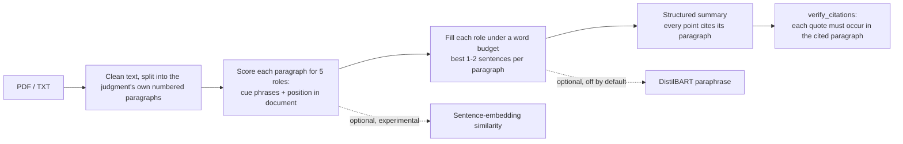

# LawLens: paragraph-cited summaries of Indian court judgments

Problem statement: *automated judgment-based document summarisation.*

LawLens reads an Indian court judgment (text PDF or .txt) and produces a structured summary (facts, issues,
arguments, the court's reasoning, outcome). **Every point carries the number of the paragraph it came from,
and shows the source paragraph with the quoted sentences highlighted**, so a reader can check any claim in
seconds. Nothing is trained: it uses cue phrases, a position prior and (optionally) a pretrained sentence encoder.

## Results (IN-Abs test split, 100 judgments, never used for tuning)

IN-Abs: Indian Supreme Court judgments with expert headnotes (Shukla et al., 2022). Gold summaries average 932
words. Mean F1 with 95% bootstrap confidence intervals over documents. BERTScore uses `distilroberta-base`
(unrescaled), so **do not compare it with numbers from papers**; compare only against the baseline in the same table.

| System @ word budget | ROUGE-1 | ROUGE-2 | ROUGE-L | BERTScore-F1 | words | quotes verified |
|---|---|---|---|---|---|---|
| lead@450 (baseline: first 450 words) | 0.442 [0.421, 0.466] | 0.200 [0.181, 0.222] | 0.216 [0.202, 0.233] | 0.862 [0.859, 0.865] | 450 | n/a |
| **LawLens@450** | **0.488** [0.467, 0.509] | **0.240** [0.224, 0.256] | **0.249** [0.236, 0.262] | **0.876** [0.874, 0.879] | 450 | 1369/1369 |
| lead@900 (baseline: first 900 words) | 0.486 [0.462, 0.508] | 0.247 [0.227, 0.268] | 0.245 [0.229, 0.263] | 0.862 [0.859, 0.865] | 890 | n/a |
| **LawLens@900** | **0.540** [0.517, 0.561] | 0.286 [0.267, 0.305] | 0.271 [0.257, 0.286] | **0.874** [0.871, 0.877] | 794 | 2403/2403 |

How to read it:
- At 450 words the intervals of LawLens and the baseline do not overlap on any metric. At 900 words they do not
  overlap on ROUGE-1 and BERTScore; ROUGE-2 and ROUGE-L are higher but the intervals touch, so treat those two as a
  likely but unconfirmed gain. See `results/module1_inabs.md` for the paired significance table.
- The settings were chosen on training documents only and then frozen (below). A check on 50 *other* training
  documents showed the same direction with smaller gains (ROUGE-L tied at 900 words), so expect a few points of
  improvement over a strong baseline, not a large one.
- "Quotes verified" means every quoted sentence appears word-for-word in the paragraph it cites. Extractive
  output should always pass; it shows the summary is **traceable**, not that it is **correct**.

### What was tried (IN-Abs train, 50 documents, seed 0)

| Variant | Finding |
|---|---|
| Sentence embeddings (all-MiniLM-L6-v2) added to the scoring | No measurable gain over cues alone, about 40x slower. Left off by default. |
| `min_score` 0.25 / 0.35 / 0.45 | 0.25 and 0.35 identical; 0.45 slightly worse. Kept 0.35. |
| Scaling per-role point caps with the length budget | Almost no effect (583 to 588 words at a 900 budget). The real limit was how many paragraphs passed the eligibility filter. |
| Weighting position more heavily (cue/position 0.3/0.7 vs the original ~0.7/0.3) | The only change that clearly helped. Frozen as the default. |

Only one weight setting beyond the default was carried to validation and test, to limit overfitting to the training subset.

## How it works



1. `ingest.py`: text PDF or .txt to cleaned text, split into numbered paragraphs (the judgment's own numbers are kept, so `[¶12]` means paragraph 12).
2. `scoring.py` / `roles.py`: per-paragraph scores for facts, issues, arguments, reasoning and decision from regex cue phrases and a position prior (the decision is only taken from the last ~15% of paragraphs).
3. `pipeline.py`: fills each role under a word budget, keeps 1-2 sentences per paragraph, one role per paragraph, and attaches the citation. Points chosen without any cue phrase are flagged as low confidence.
4. `evaluate.py` and `scripts/eval_inabs.py`: lead baseline, ROUGE, BERTScore, bootstrap and paired-bootstrap confidence intervals.

## Run it

```bash
python -m venv .venv
# Windows: .venv\Scripts\Activate.ps1      Mac/Linux: source .venv/bin/activate
pip install -r requirements.txt
python -m pytest -q tests
streamlit run app.py
```

Reproduce the table (download `dataset.zip` from https://zenodo.org/records/7152317, unzip into `data/inabs`):

```bash
python scripts/eval_inabs.py --root data/inabs --split test --max_words 450,900 --systems lead,cues --weights 0.3,0,0.7 --bert_model distilroberta-base
```

Colab: open `LawLens_Module1.ipynb` and run the cells top to bottom.

## Limitations

- **Heuristic role detection.** Roles come from cue phrases and position, not a trained classifier. Unusual judgments (for example, ones that put the outcome first) will be mis-sorted.
- **Position-heavy.** The frozen weights lean on where a paragraph sits. On text without legal structure the system can still pick paragraphs by position alone; those points are marked low confidence in the app.
- **Extractive.** The output is quoted sentences, not a fluent abstract. The optional DistilBART paraphrase is labelled as such and was not evaluated.
- **Metrics are rough.** ROUGE and BERTScore reward overlap with one expert headnote. BERTScore truncates at 512 tokens, so it scores only the start of long summaries. No lawyer has judged these summaries.
- **Scope.** Supreme Court judgments in English with numbered paragraphs. Scanned PDFs are not supported (no OCR). IN-Abs headnotes average about 930 words, so summaries are long by design.
- **Not legal advice.** A prototype that finds and cites passages; a person must read the cited paragraph.

## Credits

IN-Abs dataset: Shukla et al., *Legal Case Document Summarization: Extractive and Abstractive Methods and their Evaluation*, AACL-IJCNLP 2022 (https://github.com/Law-AI/summarization). Sentence encoder: `sentence-transformers/all-MiniLM-L6-v2`. BERTScore model: `distilroberta-base`.
